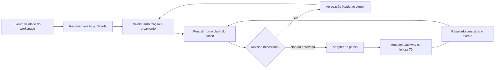

# ORKTO Playbooks 2027 — análise arquitetural inicial

**Estado: proposta documental, não implementada.** Inspeção de código em 20/10/2026, baseline documental `d663e76`, aplicação publicada `837b5e5`, core Edge31. Nenhum código, migration, job, permissão, plano ou configuração do candidato é alterado por este documento. Não constitui compromisso de lançamento em 2027 ou aprovação comercial.

## 1. Objetivo e fronteira

Um Playbook será uma sequência versionada de passos comerciais autorizados para uma empresa, com condições explícitas, pontos de revisão humana, orçamento e resultado auditável. A WIA pode sugerir o próximo passo; o executor valida o contrato e a autorização antes de produzir qualquer efeito.

Primeiro recorte proposto: leitura de contexto e preparação de tarefa interna para revisão. Envios, alterações financeiras, descontos, contratação e inferência paga não entram automaticamente nesse recorte. Inbox continua responsável por conversas e recibos; Playbooks não cria um segundo inbox nem transforma sugestão em mensagem enviada.

Exemplo de produto, ainda hipotético: oportunidade sem avanço → consultar contexto próprio → preparar tarefa de acompanhamento → aguardar aprovação → executar somente a tarefa interna autorizada → registrar resultado. Nenhum prazo, preço ou franquia foi definido aqui.

## 2. O que existe de fato na fonte atual

| Componente | Evidência no repositório | Reutilização proposta / limite |
| --- | --- | --- |
| Contexto e contratos WIAOS | [core-contracts.ts](../../backend/wiaos/core-contracts.ts), [contracts.ts](../../backend/wiaos/contracts.ts) | Trace, tenant, schemas, fontes e erros tipados. Os contratos são base; sua existência não prova fluxo remoto homologado. |
| Registro de ferramentas | [tool-registry.ts](../../backend/wiaos/tool-registry.ts), [t0-tools.ts](../../backend/wiaos/t0-tools.ts) | Validação de entrada/saída e leituras delimitadas. As permissões registradas são de **leitura**; não estender o registry para escrever diretamente no banco. O timeout envolve a Promise, sem provar cancelamento da operação subjacente. |
| T0 confiável e geração controlada | [_shared/wia-trusted.ts](../../supabase/functions/orkto-core-mutations/_shared/wia-trusted.ts), [_shared/wia-request.ts](../../supabase/functions/orkto-core-mutations/_shared/wia-request.ts) | Consultas computadas no servidor, contexto de workspace, saída como decisão/rascunho. Não aceitar uma conclusão de execução enviada pelo cliente ou pelo modelo como fato auditado. |
| Mutation Gateway | [core-mutation-client.ts](../../backend/core-mutation-client.ts), [Edge index.ts](../../supabase/functions/orkto-core-mutations/index.ts) | Endpoint por ambiente, usuário autenticado, membership, comandos allowlisted, payload validado, request/idempotency key e respostas controladas. Futuro step adapter chama comandos de domínio existentes, sem SQL/URL arbitrários. |
| Proveniência e replay WIA | [migration de proveniência](../../supabase/migrations/20261016020000_wia_request_provenance.sql) | Claim do request com fingerprint, run bloqueado e resultado persistido. Base para deduplicação; não é scheduler geral com retomada de múltiplos passos. |
| Aprovação de ação interna | [wia_decide_command](../../supabase/migrations/20261004010000_core_wia_decision_gateway.sql), [approval task gateway](../../supabase/migrations/20261009175400_core_approval_task_decision_gateway.sql) | Locks, autorização, conflitos e trilha. A primeira cria tarefas internas para tipos suportados; aprovar não comprova envio externo. Approval tasks ligadas a conversas não devem receber IDs fictícios para acomodar Playbooks genéricos. |
| Jobs e runs existentes | [schema operacional](../../supabase/migrations/20260926192349_orkto_full_operational_v01.sql), [repurchase-scheduler.ts](../../backend/orkto-core/repurchase-scheduler.ts) | `orkto_automations`, `orkto_automation_jobs`, `orkto_automation_runs`, due_at, attempts e idempotência por workspace. São peças de domínio; ainda é necessário demonstrar claim concorrente, lease, fencing, recuperação e histórico por tentativa para um executor geral. |
| Pulso / Cost Governor | [_shared/cost-governor.ts](../../supabase/functions/orkto-core-mutations/_shared/cost-governor.ts), [migration comercial](../../supabase/migrations/20261016060000_commercial_billing_pulso.sql) | Reserva durável e settlement, política aprovada e tarifa efetiva antes de custo. Valores de referência do código não são franquias comerciais aprovadas. Custo estimado não é caixa liquidado. |
| Meta / billing | Funções e adapters já presentes, com claims e reconciliação | Reaproveitar protocolos de confirmação e estados unknown. Configuração, acesso ao fornecedor e autorização de consumo continuam gates externos; nenhuma integração é ativada pelo Playbook. |

**Atenção aos documentos históricos:** `docs/WIAOS-IMPLEMENTATION.md` contém instruções antigas sobre provider/fallback, com cabeçalhos de correção. A autoridade desta análise é a fonte atual e o relatório de homologação. A enumeração TypeScript ainda citar `START_WIA_RUN`/`COMPLETE_WIA_RUN` não autoriza esses comandos públicos na Edge atual. O comentário “executa playbooks” em `policy-engine.ts` também não implementa um runtime de Playbooks.

## 3. Decisões arquiteturais propostas

### Definição declarativa e versão imutável

- Usar uma DSL de dados validada por schema: tipos de passos allowlisted, dependências, referências de fontes, condições, política de erro e pontos de aprovação.
- Rejeitar JavaScript, SQL, expressões eval, URLs livres, ferramentas escolhidas arbitrariamente pelo LLM e dependências cíclicas. Limites de tamanho/profundidade/iterações serão definidos e testados na implementação, sem inventar direitos comerciais.
- Cada versão publicada é imutável. Run referencia versão e digest do contrato. Editar um rascunho não altera runs existentes; migrar uma execução exige ação explícita e nova revisão dos passos afetados.
- Modelo sugere uma definição ou parâmetros; saída de IA é entrada não confiável e nunca concede capacidade.

### Um executor, comandos de domínio existentes

O diagrama é uma proposta; não representa um serviço em execução. O retorno de aprovação revalida permissões e estado e só libera o passo com aprovação válida para o digest atual. O laço de execução só continua enquanto houver próximo passo elegível; runs terminais não voltam à fila.

- Separar o planejador WIA, o executor e o adaptador de comando. O executor só avança após confirmação persistida do passo.
- Na retomada, revalidar membership/delegação, política publicada, consentimento, disponibilidade do recurso, orçamento e aprovação. Um owner anterior não preserva acesso depois de removido.
- Derivar uma chave estável por `(workspace, run, step, efeito lógico)`; retry não cria chave aleatória nova. O cliente atual gera UUID se a chave não chega: o adapter deverá fornecer a chave estável explicitamente.
- Não prometer exactly-once no fornecedor: combinar entrega com repetição, idempotência e reconciliação. Timeout depois do envio resulta em `reconciliation_required`, sem repetição cega.

### Execução agendada e identidade

O gateway atual pressupõe uma requisição autenticada. Um worker futuro não deve armazenar JWT/refresh token de usuário para executar meses depois, nem fabricar `p_actor_user_id` com service_role como substituto de autorização.

Desenhar separadamente uma delegação revogável, limitada a workspace, versão, comandos e duração, com aprovador e trilha. Sua implementação exige revisão própria de RLS/ACL/RPC e testes negativos. Até existir essa delegação, limitar o primeiro incremento a execução interativa com sessão válida. Identidade de trabalhador e autor humano ficam distintos na auditoria; nenhum papel global novo é concedido por este documento.

### Aprovação, cancelamento e concorrência

Uma aprovação deve vincular versão, passo, destinatário/recurso, payload canônico, política e expiração. Mudança material invalida a autorização. Texto de e-mail, mensagem ou documento externo não constitui aprovação.

Claims precisam de lease e fencing para um worker atrasado não confirmar passo retomado por outro. Pause/cancel não desfaz efeito externo confirmado; bloquear passos ainda não iniciados e reconciliar os que já estavam em voo. Não executar “compensação” financeira ou apagar histórico automaticamente.

Estados propostos de run: `queued`, `running`, `waiting_approval`, `paused`, `reconciliation_required`, `succeeded`, `failed`, `cancelled`. Estados não representam novas tabelas já entregues. O passo deve distinguir `not_started`, `claimed`, `confirmed`, `failed` e resultado ambíguo; fila vazia não prova sucesso.

## 4. Dados e segurança — desenho a validar

Entidades lógicas futuras: definição, versão, run, step-run, tentativa, vínculo de aprovação e evento. Avaliar extensões dos jobs/runs atuais antes de duplicar tabelas. Não há migration neste estudo.

- Todas as referências incluem `workspace_id`; FKs de domínio precisam impedir vínculos entre empresas, e não apenas filtrar SELECT. RLS de leitura e escrita permanece tenant-aware, com grants mínimos.
- Deduplicar trigger por `(workspace, origem, evento, versão)`. IDs externos e texto de eventos são não confiáveis; validar proveniência antes de acionar passos.
- Salvar referências e digests, evitando copiar conversas inteiras para o ledger. Logs não guardam tokens, segredos, payload financeiro ou prompt sensível. Retenção/exportação/exclusão dependem de política aprovada.
- Histórico precisa reconstruir evento → versão → autorização → reserva → claim → comando → confirmação/reconciliação. Cada fato declara se foi observado, estimado ou confirmado pelo fornecedor.
- Separar efeitos de acesso comercial de estados técnicos do run. Não inventar corte por inadimplência, graça, assentos ou tarifa adicional para Playbooks.

## 5. Escopo incremental recomendado para análise

| Incremento futuro | Reutilizar | Entrega que precisará ser comprovada |
| --- | --- | --- |
| Validador e prévia sem efeitos | Schemas / T0 / fontes | Validar definição e explicar passos/custos bloqueados, sem iniciar execução. |
| Execução interativa interna | Gateway / tarefas / aprovações | Sessão válida, autorização por passo, idempotência, histórico e recusa após revogação. |
| Espera e retomada durável | Jobs existentes / claims | Concorrência, lease/fencing, recuperação de crash, cancelamento e conflito de versão. |
| Integrações externas | Adapters reais já existentes | Somente após homologação dos fornecedores, consentimento, políticas comerciais e autorização explícita por capacidade. |

O horizonte 2027 orienta a análise; a ordem não define datas, contratação de infraestrutura ou ativação no piloto. Não escolher serviço pago antes de medir as necessidades e obter autorização.

## 6. Critérios de aceitação para uma implementação futura

1. Duas empresas: negar trigger, leitura, alteração, aprovação e retomada cruzados por API, Edge e RLS, inclusive FKs e IDs forjados.
2. Repetir evento/comando, disputar workers e reiniciar após crash sem duplicar tarefa/efeito lógico; conflito de payload mantém falha explícita.
3. Remover papel, expirar aprovação ou revogar delegação durante uma espera impede o passo seguinte.
4. LLM/inbound content não consegue injetar ferramenta, endpoint, schema ou autorização.
5. Sem política Pulso/tarifa/configuração, zero chamada paga. Reserva ambígua não vira saldo liberado sem reconciliação.
6. UI não exibe sucesso/envio/entrega antes da confirmação apropriada. Aprovação de tarefa interna não vira recibo Meta ou confirmação Asaas.
7. Ensaio de recuperação preserva versão, passos confirmados, pendências e ledger; não repete efeitos externos após restore.
8. Capacidade desligada por padrão e desligamento efetivo dos passos ainda não iniciados. Limites técnicos e comerciais aprovados separadamente.

## 7. Pendências de decisão

Validar com o proprietário o primeiro caso de uso, quem publica/aprova playbooks, quais efeitos são permitidos e como tratá-los ao sair alguém da equipe. Limites de concorrência, retention, orçamento e níveis de autonomia precisam especificação e aprovação próprias. Os cinco planos atuais, Pulso, Cost Governor e Central Econômica permanecem preservados.

Este trabalho avança a arquitetura enquanto a homologação externa está bloqueada. **Não fecha G01–G12/B01–B13 nem altera READY_FOR_PRODUCTION_CANDIDATE=NO.**
