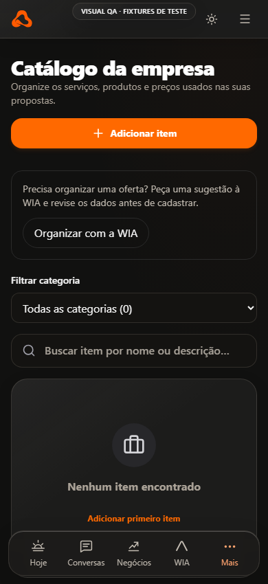
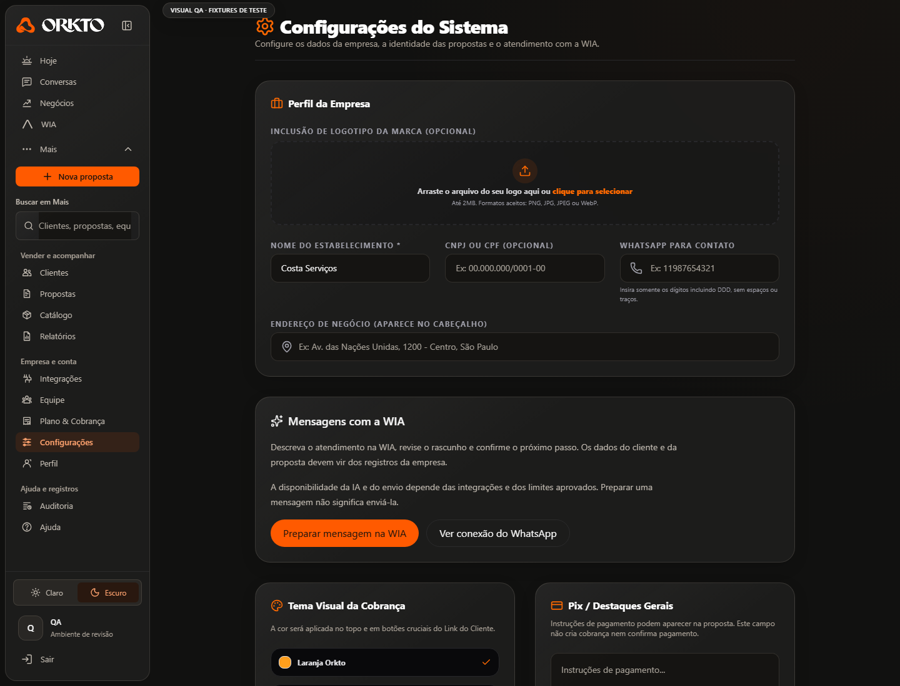

# ORKTO — ajustes dos sete comentários de produto

29/10/2026 · branch local feat/orkto-ux-research-lab-2027. Runtime final b4d25d9; sem deploy, merge ou alteração da PR2. Esta entrega complementa o ciclo UX Research Lab anterior, sem substituir suas evidências históricas.

## O que mudou

| Comentário | Implementação | Resultado e limite |
|---|---|---|
| 1. Marca leva ao início | Marca móvel vira botão acessível para Hoje no App e no harness; desktop já fazia isso. A prévia móvel usa o logotipo atual. | R1 PASS local |
| 2. Catálogo antigo | Catálogo da empresa, categorias gerais Serviços/Produtos/Outros e categorias já existentes preservadas; textos de itens em vez de modelos; filtro compacto móvel. Cadastro mantém callback real existente; foco, Escape e rolagem do formulário reutilizam o hook compartilhado. | R2/R2b PASS, salvar item fictício em memória e encaminhar pedido preenchido à WIA. Não é cadastro autônomo por IA. |
| 3. Relatórios não abre | O harness não mapeava analytics para ReportsPage, embora o aplicativo já tivesse essa tela. Ligação e leituras de fixtures adicionadas. | R3 PASS; navegação e estado vazio verificados. Geração remota/IA NÃO TESTADA. |
| 4. Conectar WhatsApp | Ação de conexão existente fica antes das instruções; linguagem compreensível explica bloqueio, papel necessário e sequência oficial na Meta. Fixture proprietário corrigida para não indicar falta de permissão quando o problema é a configuração. | R4 PASS para estado bloqueado. Não foram configurados segredos, carregado SDK externo, conectado número ou enviado mensagem real. |
| 5. Convidar equipe | Botão Convidar pessoa; e-mail, papel, geração/cópia de código privado e aceitação por código usam endpoints existentes. Criação apenas owner/admin; admin não oferece admin; owner não é papel de convite. | R5/R5b/R5c PASS com fixture. API continua impondo Google/allowlist, tenant, papel, plano, assentos e e-mail convidado. Nenhum convite real ou e-mail enviado. |
| 6. Template antigo | Editor de mensagem fixa e falsa prévia WhatsApp retirados de Configurações; substituídos por preparação na WIA e atalho de integração. Removidos checkboxes simulados sem persistência. | R6 PASS. O valor antigo salvo é preservado para não apagar dados existentes; compartilhamento manual legado de propostas não foi reescrito. |
| 7. Botão WIA | Abrir WIA recebe contorno totalmente arredondado. | R7 PASS; border-radius calculado verificado. |

## Fluxo de convite e proteção adicional

Proprietário/administrador abre Equipe → Convidar pessoa → informa e-mail e papel → servidor verifica acesso e quota → retorna código de convite de uso privado → operador escolhe como compartilhá-lo. Não há envio automático de e-mail. A pessoa entra com o Google aprovado, abre Equipe → Recebeu um convite? → cola o código. O servidor exige o mesmo e-mail, convite válido, não revogado, plano disponível e limite de pessoas.

O código fica apenas em memória do componente, mascarado, sem localStorage, logs ou relatórios. Copiar exige ação explícita do operador. A interface não faz GET no link com token e não altera a allowlist. Não foi implementado e-mail ou fluxo público de inscrição.

Ao revisar a aceitação, foi encontrado um upsert que poderia substituir o papel de um membro já existente, inclusive em replay de convite aceito. Corrigido: vínculo existente não é reativado/promovido/rebaixado por convite; retomada de aceitação ativa preserva o papel atual. Criação passa a INSERT, mantendo unicidade do banco como barreira contra substituição concorrente. O cálculo de assentos em retomada não desconta um convite que já deixou de estar pendente. Teste HTTP local protege owner contra rebaixamento e replay contra sobrescrita de papel.

**Limites ainda abertos:** conta não aprovada no piloto não passa a ter acesso por convite. O fluxo de entrada pública/sem membership continua sujeito às barreiras atuais do App; não houve homologação Google com convidado real. Não há revogação/gestão de papéis na nova interface, embora endpoints anteriores existam. O protocolo real deve validar entrega manual do código e aceitação em segunda identidade aprovada antes de declarar o onboarding público pronto.

## Verificação por camada

- Browser → interface: 10/10 cenários Chromium reais em localhost, usando dados sintéticos. Catálogo salvo somente em memória; Relatórios abre; WIA recebe texto sem consulta paga; convite usa double, não concessão real.
- API → dados → resposta: regressão existente com adapters isolados, 411/411 testes de aplicação e 108/108 de ferramentas em 7b5163d. Inclui HTTP real contra servidor de teste e banco fake para políticas, tenant e convites; não é PostgREST/RLS remoto.
- Última diferença 7b5163d→b4d25d9: somente apresentação do filtro, texto, posição do botão e teste. Typecheck, build/smoke e dez cenários + 36 combinações repetidos em b4d25d9; não repetir a suíte backend sem mudança adicional de backend.
- Matriz: seis telas ×390/768/1440 ×claro/escuro, 36 combinações sem overflow horizontal. Capturas desktop/tablet/mobile inspecionadas. Emulação não é iPhone/Android físico nem certificação WCAG.
- Build local de produção e smoke em diretório temporário aprovados; não houve publicação.
- Secret scan: resultado sanitizado em evidence/ux-comments-20261029/validation/secret-scan.log.

A primeira rodada teve 8 PASS/1 FAIL por preparação de teste que fechava Mais já aberto. A rodada seguinte passou 10/10 e a confirmação final b4d25d9 também 10/10. Rodadas anteriores preservadas; nenhum FAIL foi apagado retroativamente. Arquivos em pastas de rodadas podem incluir PNGs históricos; a captura autoritativa de cada caso é exclusivamente o nome em screenshot.file do JSON daquela execução.

## O que a WIA ainda não faz

Os atalhos preenchem um pedido para revisão; não chamam um modelo automaticamente e não gravam ofertas nem enviam WhatsApp. A engine atual e o Mutation Gateway continuam exigindo ações suportadas, aprovação e autorização. Não foi adicionada uma promessa de “toda a ORKTO automatizada”. Cadastro autônomo de catálogo por IA, fornecedor conversacional real e Meta continuam exigindo implementação/validação próprias. Esta tarefa não configura esses serviços.

Os cinco planos, preços, Pulso, Cost Governor e Central Econômica permanecem preservados. Nenhuma tarifa, franquia ou cobrança foi criada.

## Evidências

[Casos e matriz final](evidence/ux-comments-20261029/after/journeys.json) · [Capturas](evidence/ux-comments-20261029/visual-review/captures.json) · [Regressão](evidence/ux-comments-20261029/validation/regression.log).

READY_FOR_PRODUCTION_CANDIDATE=NO
