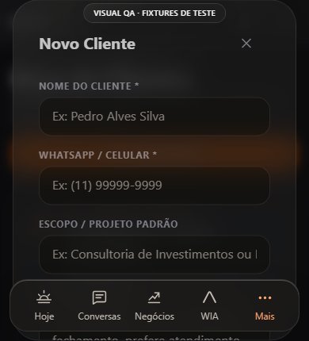
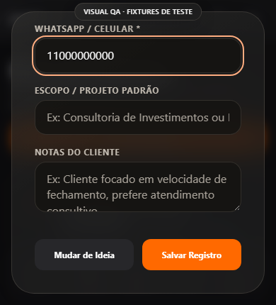
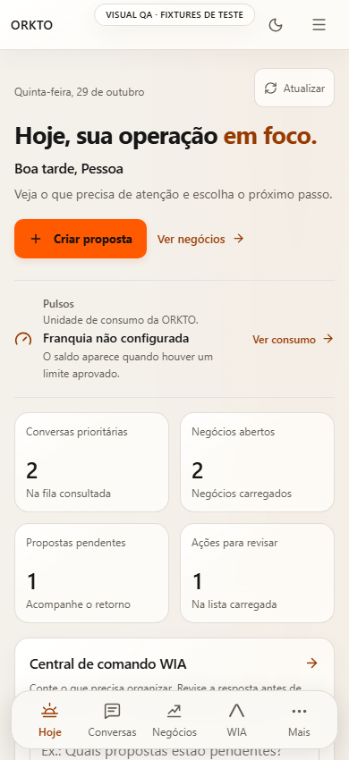
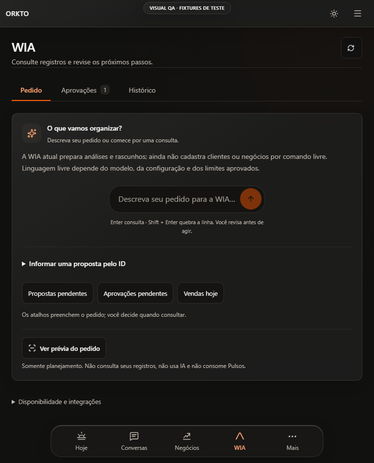

# ORKTO — antes/depois do ciclo de UX

29/10/2026 · **frontend local com fixtures**. Produto inicial c289f78; runtime corrigido04d24c9; commits posteriores alteram exclusivamente testes e documentação. Não houve deploy.

## Jornadas e regressões observáveis

| Caso | Antes | Resultado mais recente | Limite da evidência |
|---|---|---|---|
| A-first-entry | PASS | PASS | Chromium local; nenhuma validação remota |
| B-client-create-history | PASS | PASS | Chromium local; nenhuma validação remota |
| C-conversation-draft | PASS | PASS | PASS em reexecução; execução completa reteve timeout de navegação antes de interações |
| D-proposal-save-review | PASS | PASS | Chromium local; nenhuma validação remota |
| E-wia-preparation | PASS | PASS | Chromium local; nenhuma validação remota |
| F-radar-context | PASS | PASS | Chromium local; nenhuma validação remota |
| G-consumption-plans-settings | PASS | PASS | Chromium local; nenhuma validação remota |
| H-whatsapp-state-failure | PASS | PASS | Chromium local; nenhuma validação remota |
| UX01-client-modal-focus | FAIL | PASS | Chromium local; nenhuma validação remota |
| UX02-client-modal-short | FAIL | PASS | Chromium local; nenhuma validação remota |
| UX03-client-edit-labels | FAIL | PASS | Chromium local; nenhuma validação remota |
| UX04-old-approval | FAIL | PASS | Chromium local; nenhuma validação remota |
| UX05-review-context | FAIL | PASS | Chromium local; nenhuma validação remota |
| UX06-draft-switch | FAIL | PASS | Chromium local; nenhuma validação remota |
| UX07-radar-more | FAIL | PASS | Chromium local; nenhuma validação remota |
| UX08-mobile-enter | FAIL | PASS | Chromium local; nenhuma validação remota |
| UX09-edit-escape-reset | NOT_TESTED | PASS | Novo teste para regressão encontrada na revisão de Escape |
| UX10-desktop-enter | NOT_TESTED | PASS | Novo teste desktop/IME; tentativa de envio interceptada pela fixture503 |

A rodada completa posterior registrou 16/17 PASS e 1 FAIL de transporte local. C passou na reexecução pontual, sem mudar o produto. Portanto os18 casos distintos têm um resultado PASS identificado, **não houve uma única execução integral 18/18**. Preservamos a falha original.

As mesmas56 combinações DOM (Hoje, Clientes, Conversas e WIA ×320/360/390/430/768/1024/1440 ×claro/escuro) apresentaram zero overflow horizontal antes e depois. Isso não certifica acessibilidade, toque, teclado virtual ou leitura em aparelhos reais.

## Evidência visual selecionada

Cadastro antes, altura430px: formulário cortado e navegação por cima.

Cadastro depois, mesma dimensão, rolado ao final: Salvar Registro acessível e livre do dock. O teste de ponto central também confirma que o botão não está encoberto.

Hoje após a correção, mobile claro; define Pulsos sem atribuir franquia e mantém as funções existentes.

WIA depois, tablet escuro: Pedido/Aprovações/Histórico e limite da capacidade visível antes de consultar.

## Métricas de interação

As contagens nos JSONs registram ações do robô que concluíram, não tentativa humana, SUS ou produtividade. A busca, o formulário e o salvamento continuam com os mesmos passos intencionais; este ciclo resolveu impedimentos e perda de contexto. Não foi demonstrada redução de tempo humano nem taxa de conversão. Duração de automação inclui compilação local, carga da máquina e timeouts, logo não foi usada como melhoria de usabilidade.

O teste de draft demonstra texto preservado na troca dentro da Inbox montada; não é sincronização, salvamento de rascunho no servidor ou persistência após reload. A aprovação contextual abre a revisão, não executa a ação. O Radar expande apenas os sinais retornados, preservando a indicação de consulta parcial.

Usar [índice de evidências](evidence/ux-research-lab-20261028/README.md) para fontes e exceções de captura. READY_FOR_PRODUCTION_CANDIDATE=NO.
